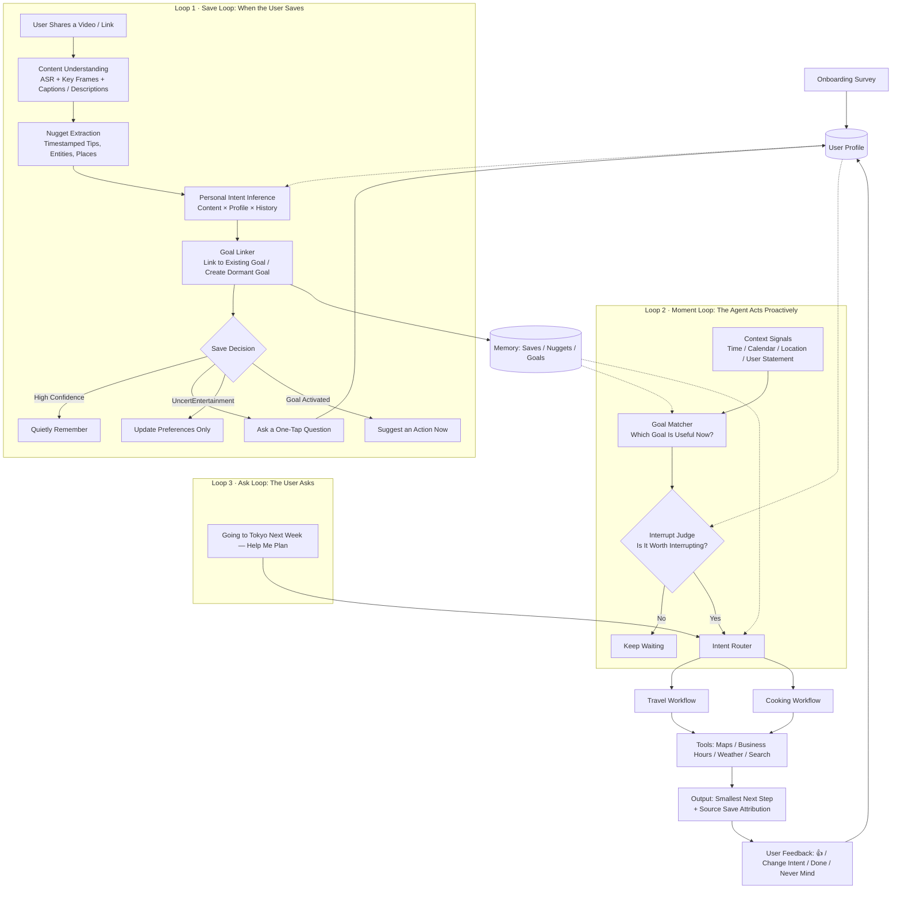

# ReMind — Project Overview & Three-Week Plan (v1)

> Date: October 7, 2026 | Internal demo: October 21 | Submission: October 29 (deadline: October 30, 10:00 a.m. PDT)
> Track: Nebius × NVIDIA Global AI Hackathon — Personal AI/Best App

---

## 0. In One Sentence

> **The same save means different things to different people. ReMind understands why you saved it and turns it into your next step at the right moment.**

Pitch:
> *ReMind treats every save as a signal of personal intent — it learns what a save means to **you**, and brings it back as the right action at the right moment.*

---

## 1. What We Want to Build

Every day, we scroll through TikTok, Reels, and Shorts. When something looks useful — a restaurant, recipe, travel guide, workout, or interview tip — we hit “Save.” Then we never open it again.

**ReMind is a personal agent that treats your saves as signals of intent, rather than just bookmarks.** It does three things:

1. **Understand:** Identify the few seconds in a video that are actually useful (a Nugget).
2. **Infer:** Use who you are, what you have been doing lately, and how you have treated similar saves in the past to infer why you saved it (Intent).
3. **Decide:** Determine whether to act now. If action makes sense, suggest the smallest, most concrete next step. Otherwise, quietly remember it.

---

## 2. Where the Idea Came From

| Stage | Insight |
|---|---|
| Hazel’s observation | Saving ≠ acting. We do not lack information; we lack a way to turn saved information into action. |
| Hazel’s insight | A save represents **intent**: saving five Tokyo restaurants may mean someone is planning a trip. |
| Our next observation | The same “Save” action can represent completely different intentions: wanting to visit, try, or learn something; appreciating its appearance; or simply enjoying it. |
| **Our core approach** | Intent depends not only on the content, but also on **the person**. The same tennis tutorial is a “practice plan” for someone learning tennis and “entertainment” for someone who only enjoys watching matches. **The agent must understand the user before deciding how to handle a save.** |

---

## 3. Core Insight: Personal Intent = Content × Person × Context

```text
   What is this video?        Who are you? What are your habits?        What is happening now?
       (Content)         ×          (Profile + History)           ×          (Context)
                                             ↓
                            What does this save mean to you?
                            What should we do for you now — if anything?
```

### One Save, Three People, Three Outcomes: The Core Comparison in Our Demo

**Saved content: A Reel titled “Five Must-Try Ramen Spots in Tokyo”**

| User | Profile / Context | Agent’s Interpretation | Agent’s Behavior |
|---|---|---|---|
| Mia | Graduate student; wrote “Japan trip in December” in the survey; recently saved six Tokyo-related videos | Visit, high confidence; link to the “Tokyo Trip” goal | Add the restaurant to a shortlist for the trip, with the tip “Go before 11 a.m.”; proactively organize the list when a flight appears on the calendar |
| Leo | Food enthusiast living in Dallas; has never mentioned Japan; previously labeled food saves as “Just makes me hungry” | Craving / Entertainment | Take no action. Only update the preference “Likes ramen.” May suggest a **local** ramen spot over the weekend |
| Sam | Enjoys cooking; wrote “I like recreating restaurant dishes” in the survey; often actually cooks saved recipes | Try / Cook | Ask “Want to recreate this at home?” Then find a matching recipe and list the ingredients |

**Saved content: A “10-Minute Backhand Fix” video**

| User | Agent’s Behavior |
|---|---|
| Currently learning tennis (selected “Currently learning” in the survey) | Extract the key movement at 0:42 → send a Saturday morning prompt: “Practice just this one movement today” |
| Watches matches but does not play | Quietly archive it without interrupting |

> Existing products mostly categorize saves by content, so they treat the same save the same way for everyone. **This table shows our differentiator.**

---

## 4. Four Core Concepts + the User Profile

### 4.1 User Profile: What Enables the Agent to Personalize Its Behavior

| Source | What It Captures | How We Collect It | MVP Approach |
|---|---|---|---|
| **Onboarding Survey** | Cold-start information: who you are, upcoming plans, and daily habits | A three-minute questionnaire | ✅ Implement |
| **Save History** | What you save, how much you save, and which topics are clustering | Automatic statistics | ✅ Implement |
| **One-Tap Feedback** | “Want to go” / “Just browsing” / “Leave it alone” | A quick tap when saving | ✅ Implement |
| **Action History** | Whether you actually followed through: cooked the dish, visited the restaurant, etc. | User checks it off / agent asks briefly | ✅ Simple version |
| **Context** | Time, calendar, location, and weather | Real integrations or simulation | 🟡 Simulate with a “Context Simulator” |

**Survey draft: 6–8 questions, each of which must directly affect an agent decision:**

1. What city do you live in, and what is your current role (student, working professional, etc.)?
2. What plans do you have for the next three months? (Travel destinations / job search and interviews / moving / exam preparation / none.)
3. What skills or hobbies are you **actively learning** right now? (Distinguish “currently doing” from “just interested.”)
4. How often do you cook? Do you have dietary restrictions or budget preferences?
5. When you save recipes, restaurants, or outfits, do you usually intend to actually try them, save them for later, or simply enjoy looking at them?
6. How proactive would you like me to be? (Only when you ask / one weekly recap / reminders when the right moment comes.)
7. (Optional) When would you least like to be interrupted?

**Profile storage: keep it simple.** Store a natural-language profile summary plus a small table mapping “category → your usual intent,” with counts. Include both in the prompt each time the LLM makes an inference.

### 4.2 Nugget

The few seconds in a video that are actually useful, with a timestamp. Examples: “0:42: backhand power technique” or “Go before 11 a.m. to avoid the line.”

### 4.3 Intent Guess

What this save means to **this person**, with a confidence score and an explanation.

Start with six intent categories for the MVP: `Visit` / `Try·Cook` / `Learn·Practice` / `Buy` / `Taste·Preference` / `Just-for-fun`.

### 4.4 Latent Goal: The System’s Central Unit

An unspoken user goal that emerges from a cluster of saves, with its own lifecycle:

```text
 dormant ──(more related saves)──▶ emerging ──(a moment arises / user confirms)──▶ active ──▶ done
    ▲                                                                                       │
    └────────────(no new saves for a long time / user says “never mind”)──── fading ◀─────────┘
```

### 4.5 Moment

A context that makes a goal useful **right now**: a flight appears on the calendar, it is Friday dinnertime or Saturday morning, or you happen to be near the restaurant.

---

## 5. Feature List

### Must: Required Before the October 21 Internal Demo

- [ ] Onboarding survey → generate an initial profile
- [ ] Enter a video link / upload a video → extract Nuggets (transcription + key frames + captions or descriptions)
- [ ] **Personalized intent inference** (content + profile + history) → intent + confidence + explanation
- [ ] Decide whether to quietly remember, ask a one-tap question, link to a goal, suggest an action immediately, or take no action — **and show the reason**
- [ ] Latent Goal clustering + status (at least dormant → emerging → active)
- [ ] Context Simulator (change the date, time, and location; add calendar events) → trigger proactive cards
- [ ] Two complete workflows: **Travel** (organize a shortlist by area + check whether places are still operating) and **Cooking** (suggest what to cook tonight + an ingredient list)

### Should: Before October 29

- [ ] One-tap feedback → update the profile → visibly change the next inference (demonstrable live)
- [ ] “Smallest next step” output (jump to a specific video timestamp; suggest something doable in ten minutes)
- [ ] Identify which saved item each output item comes from
- [ ] A comparison demo with three personas + a small evaluation

### Could: If Time Allows

- [ ] Save backlog reminder (“You saved 12 recipes and cooked 0”)
- [ ] Graceful forgetting (ask briefly when a goal is fading; automatically flag restaurants that have closed)
- [ ] Telegram bot entry point (save through the phone’s “Share” menu; receive proactive agent messages)
- [ ] A third workflow (Learning / Fitness)

### How Saves Enter the Agent: Input Methods

Third-party apps cannot intercept the “Save” buttons inside other apps, and TikTok and Instagram do not provide public APIs for reading a user’s saves. We therefore separate ingestion into “live” and “historical” paths:

| Path | Method | User Action | MVP |
|---|---|---|---|
| Live | Paste a link into the web app | Copy, then paste | ✅ Build first |
| Live | An iOS Shortcut or Telegram bot appears in the system “Share” menu and POSTs the link to our backend | Tap “Share,” then ReMind | 🟡 Could |
| **Historical** | **Upload an official “Download My Data” export** (TikTok or Instagram JSON) to bulk-import a timestamped list of saves | One-time operation | ✅ Should (high value for user profiling) |
| Historical | Platforms with OAuth APIs: YouTube (liked videos and user-created playlists), Pinterest, Reddit | Authorize once | ❌ Roadmap |
| ✗ | Scraping or simulating login with a user’s account | — | Out of scope (violates platform terms, risks account bans, and makes the demo unreliable) |

**Importing historical saves addresses the cold-start problem.** Hundreds of timestamped saves can help infer who you are and which goals are emerging — for example, a sudden increase in Tokyo-related saves over the past two weeks. This complements the survey: the survey describes who you **think** you are, while save history shows what you are **actually** paying attention to.

Export packages contain links and timestamps, not video files. Use a tiered processing approach: first fetch only metadata (titles, captions, and hashtags) with yt-dlp for rough classification; download and deeply analyze only videos linked to active goals.

### Explicitly Out of Scope

- Scraping, support for every platform, and a complex multi-agent architecture

---

## 6. Relevant Fields: Also Useful for Our Resumes

| Field | Role in the Project | Reuse Existing Tools or Design Ourselves? |
|---|---|---|
| Multimodal understanding (ASR + VLM) | Video → text and key frames → Nuggets | Reuse existing tools (Nebius / NVIDIA models) |
| Structured extraction | Nuggets, entities, places, and ingredients | Reuse existing tools (LLM + JSON schema) |
| **User modeling / personalization** | Profile, intent priors, and feedback updates | **Design ourselves** ⭐ |
| **Intent inference** (implicit feedback in recommender systems) | Save → intent | **Design ourselves** ⭐ |
| Agent memory | Store and retrieve saves, goals, and profiles | Reuse existing tools (SQLite + a vector database / mem0) |
| **Proactive agents / mixed-initiative interaction** | Decide when to interrupt and when to stay quiet | **Design ourselves** ⭐ |
| Tool use / MCP | Maps, business hours, weather, and search | Reuse existing tools |
| HCI / product design | One-tap feedback, explanations, and the smallest next step | **Design ourselves** ⭐ |

> ⭐ = Where we should focus our effort.

---

## 7. Existing Products & How We Differ

> ⚠️ Most of the information below comes from official websites and App Store descriptions. **During Week 1, each person should install and try 1–2 competitors** to confirm what they actually deliver.

| Category | Representative Products | What They Offer | What They Do Not Address, or Address Only Lightly |
|---|---|---|---|
| Built-in platform saves | TikTok / IG Collections | Saved items and manually created folders | Do not understand the content, much less the user |
| AI bookmark managers / knowledge bases | mymind, Recall, Raindrop, Karakeep (open source) | Automatic tags, summaries, semantic search, and “chat with your saves” | Focus on **retrieval**, rather than **putting saves to use**; lean toward long-form content and knowledge |
| “Save → action” apps | Sorti, Fofo, LastPage, Mira, Vestron, Ordo | Categorize by **content** (recipes / places / shopping), extract information; some offer reminders and “action plans” | Categorization and actions are **the same for everyone**; reminders are mostly time-based rather than grounded in the user’s life context; rarely decide that a save should not prompt action |
| Vertical products | ReciMe, SAVY (recipes); Triply, Wandereel, ReelsTrip (travel) | Deep support for one domain: recipe cards, map pins, and itinerary generation | Handle only one domain; do not know whether the user actually intends to visit or try what they saved |
| Proactive general assistants | ChatGPT Pulse (OpenAI; daily proactive suggestions based on memory) | Proactive behavior based on conversation memory | Signals come from conversations rather than saves; “save → intent → goal” is not the core model |

### Our Differentiators in Four Sentences

1. **Others categorize content; we infer intent based on the person.** The same save leads to different treatment for different users (see the table in Section 3).
2. **Others use an individual save as the unit; we use a latent goal.** Saves grow into goals, and goals have lifecycles.
3. **Others tend to turn every save into a task; we decide when no action is appropriate**, and explain why.
4. **Others give you a plan; we give you the smallest next step**, at the right moment: ten minutes today, starting at 0:42.

> To be candid, this space already has plenty of apps (Sorti raised a seed round in February 2026), which suggests real demand. We do not need to invent an entirely new category. We need to **clearly demonstrate personalized intent in the demo**. For a hackathon and portfolio project, that is enough.

---

## 8. Agent Workflow

### 8.1 Overview



### 8.2 Inputs, Outputs, and Key Decisions at Each Step

**Loop 1 · Save Loop: Fast and Quiet**

| Step | Input | Output | Key Decision / Design |
|---|---|---|---|
| ① Content Understanding | Video link / file | Transcript, key-frame descriptions, captions or descriptions | Reuse existing tools |
| ② Nugget Extraction | Results from ① | Timestamped `nuggets[]`, `entities[]`, and `category` | Keep only actionable information; discard filler |
| ③ **Personal Intent Inference** | Nuggets + **Profile** + recent saves + historical intents for that category | `intent`, `confidence`, `reason` | **Core component.** The explanation must reference the profile or history, e.g., “Because you said you are visiting Japan in December” |
| ④ Goal Linker | New save + existing goals | Goal assignment / new goal; updated goal status | Save count + intent consistency + plans in the profile → decide whether to move from dormant to emerging |
| ⑤ **Save Decision** | ③ + ④ + proactivity preference in the profile | Stay quiet / ask a one-tap question / record preferences only / suggest an action now | Ask only when confidence is low **and** the category has no history; otherwise, avoid interrupting |

**Loop 2 · Moment Loop: The Core of Our Novelty**

| Step | Input | Output | Key Decision / Design |
|---|---|---|---|
| ⑥ Context Signal | Context Simulator: date, time, location, calendar events | Current context description | Simulate all context signals in the MVP |
| ⑦ Goal Matcher | Context + all emerging / active goals | Candidate goals + relevance scores | “Friday, 6 p.m.” ↔ cooking goal; “Calendar: flight to Tokyo” ↔ Tokyo goal |
| ⑧ **Interrupt Judge** | Candidate goals + profile (proactivity, quiet hours) + recent notification history | Notify / do not notify + reason | At most 1–2 notifications per day; no proactive notifications if the user selected “Only when I ask” |

**Loop 3 · Ask Loop**

| Step | Input | Output |
|---|---|---|
| ⑨ Intent Router | Activated goal or user question | Select a workflow |
| ⑩ Workflow + Tools | Nuggets under that goal + external tools | Smallest next step / list, with a source for every item |
| ⑪ Feedback | User’s taps | Update the profile and goal status → affect the next ③ and ⑧ |

### 8.3 Two Workflows

**Travel**

```text
All saves under a goal → extract places → deduplicate → check operating status and locations (Places API)
→ group by area → rank using the profile (budget, diet) → area-based shortlist / simple itinerary
→ attach “source save + tip from the video” to every item → flag closed or outdated places
```

**Cooking**

```text
All recipes under a goal → extract ingredients and steps → apply the profile (dietary restrictions, cooking skill, time)
→ choose one dish that is easiest to make tonight → generate a list of missing ingredients
→ attach “Jump to 1:15 in the video for the key step”
```

### 8.4 Minimal Data Structures: Keep Them Practical

```jsonc
// Save
{ "id": "s_012", "url": "...", "nuggets": [{"t": "0:42", "text": "Go before 11 a.m. to avoid the line"}],
  "entities": [{"type": "place", "name": "Ichiran Shibuya"}], "category": "food",
  "intent": {"type": "visit", "confidence": 0.82, "reason": "Survey: Japan trip in December; already has 6 Tokyo saves"},
  "goal_id": "g_tokyo", "decision": "silent", "feedback": null }

// Goal
{ "id": "g_tokyo", "title": "Tokyo Trip", "status": "emerging",
  "save_ids": ["s_003", "s_007", "s_012"], "evidence": "7 Tokyo saves + survey mentions a Japan trip in December",
  "last_triggered": null }

// Profile
{ "summary": "UTD graduate student, limited budget, visiting Japan in December, learning tennis, rarely cooks",
  "proactivity": "moments_only", "quiet_hours": ["22:00-08:00"],
  "category_habits": { "recipe": {"try": 1, "just_for_fun": 6}, "outfit": {"taste": 5} } }
```

---

## 9. Demo Script: Three Minutes

1. **Two people, the same 15 saves** (side-by-side view: Mia vs. Leo).
2. Save five Tokyo videos, four recipes, two tennis videos, two outfit videos, and two cat videos in sequence. The audience sees **different judgments for the same save on each side**, with explanations.
3. **A goal emerges:** Mia’s “Tokyo Trip” moves from dormant to emerging; no such goal emerges for Leo.
4. **A moment triggers action:** Add “Flight to Tokyo on October 28” for Mia in the Context Simulator → a proactive card appears with an area-based shortlist, flagging one restaurant that has closed.
5. **Correction:** Leo taps “I only browse outfits for fun” → the agent no longer asks about the next outfit save.
6. Close with: *“Same saves. Different people. Different actions.”*

---

## 10. Evaluation: Small but Convincing

| Evaluation | Method |
|---|---|
| Does personalization work? | Three personas × 15 saves; compare intent accuracy for **content only** vs. **content + profile**, using manually labeled ground truth |
| Does the agent interrupt unnecessarily? | Measure the proportion of entertainment / preference saves that incorrectly trigger actions (false-positive action rate) |
| Is the output useful? | Teammates and friends conduct a blind comparison: ReMind’s Tokyo shortlist vs. asking ChatGPT directly for a “Tokyo travel guide” |


---

### References: Sources for Competitor Information

- [Sorti – App Store](https://apps.apple.com/us/app/sorti-all-in-one-place/id6478935311) · [Sorti Funding Information](https://startupim.com/company/sorti)
- [Fofo](https://apps.apple.com/us/app/id6738624828) · [Mira](https://apps.apple.com/app/id6755054123) · [LastPage](https://apps.apple.com/us/app/-/id6593660555) · [Ordo](https://www.scriptbyai.com/organize-reels-shorts-ordo/)
- [Recall: Best AI Bookmark Managers 2026](https://www.recall.it/compare/best-ai-bookmark-managers) · [Best AI Bookmark Managers 2026](https://contextbolt.com/blog/best-ai-bookmark-managers/)
- [ReciMe (TechPP)](https://techpp.com/2026/06/18/turn-instagram-food-videos-to-actual-recipes/) · [SAVY](https://usesavy.com/blog/recipe-keeper-apps)
- [Triply: Save Places from Reels to a Map](https://triply.au/blog/best-apps-save-travel-places-instagram-tiktok/) · [Wandereel](https://www.wandereelapp.com/) · [ReelsTrip](https://reelstrip.com/tiktok-travel-planner)
- [Introducing ChatGPT Pulse](https://openai.com/index/introducing-chatgpt-pulse/)
